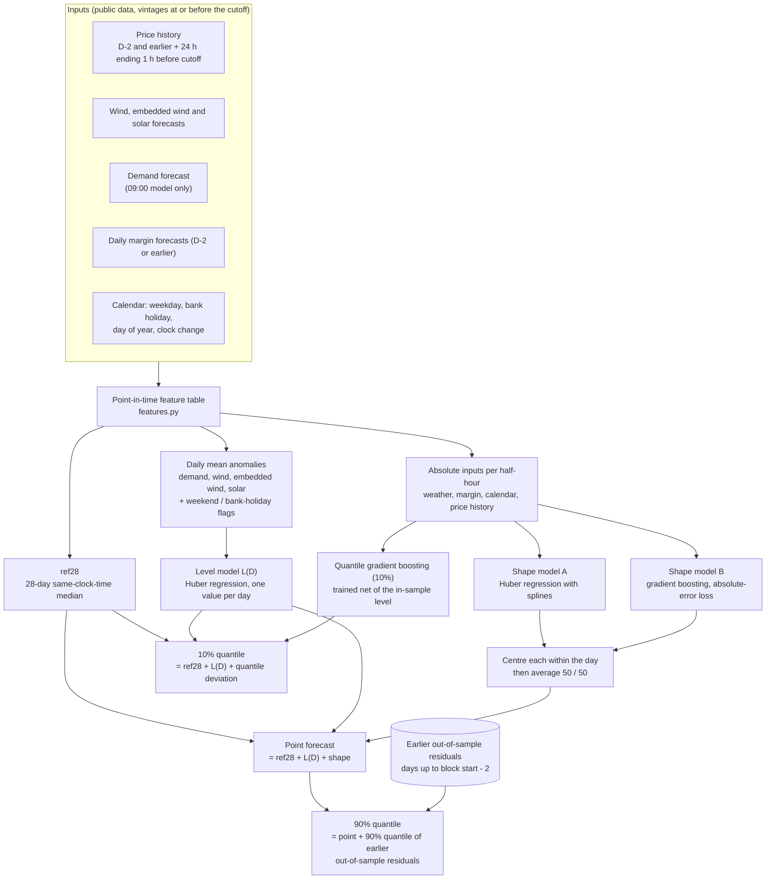

# System Imbalance Price Forecaster

Day-ahead forecasts of the GB System Imbalance Price (SIP, £/MWh) for every half-hour settlement
period of a UK day D, produced at **07:00** and **09:00 UK time on D-1**.

Data: see [`candidate_data/README.md`](candidate_data/README.md). Parquet files are tracked in git;
the CSV copies are git-ignored.

## Result in brief

The forecast is the 28-day same-clock-time median plus a daily level adjustment plus an equal blend of a Huber and a gradient-boosting
within-day shape, with 10% and 90% quantiles. On the 56-day hold-out (scored once) it lowers MAE from 48.4 to 44.2 (09:00) and 44.7 (07:00)
and RMSE from 62.6 to 55.4 / 56.2. The improvement in picking the best and worst half-hours of a day is small and not statistically
distinguishable from zero, the 10% quantile beats the baseline on pinball loss, and the 90% quantile does not (both intervals are too narrow).
Full method, tables and caveats: [`docs/REPORT.md`](docs/REPORT.md).

### Hold-out results (56 UK days, 2026-08-06 to 2026-09-30, scored once)

Models are refitted at the start of each 28-day block. The baseline is the 28-day same-clock-time median (`ref28`) and its
empirical 10% / 90% quantiles. Top-8 / bottom-8 hit is the share of the day's 8 highest / lowest half-hours the forecast picks
(random = 0.167). "Below q10" and "above q90" are the share of actual prices outside the forecast quantiles (nominal 10% each).

| | MAE | RMSE | top-8 hit | bottom-8 hit | pinball 10% | pinball 90% | below q10 | above q90 |
| --- | --- | --- | --- | --- | --- | --- | --- | --- |
| baseline | 48.42 | 62.58 | 0.464 | 0.379 | 11.42 | 10.19 | 12.9% | 20.8% |
| model, 09:00 | 44.15 | 55.44 | 0.471 | 0.395 | 9.45 | 10.48 | 18.6% | 23.7% |
| model, 07:00 | 44.69 | 56.22 | 0.478 | 0.402 | 10.04 | 10.77 | 18.8% | 23.8% |

MAE and RMSE are in £/MWh. The MAE gain is reliable (better on 41 of 56 days at 09:00). The ranking gain is not distinguishable
from zero. The 90% quantile is worse than the baseline's. Development back-test numbers, bias and caveats are in
[`docs/REPORT.md`](docs/REPORT.md).

## Setup

```bash
uv sync
```

## Usage

```bash
uv run python -m sip_forecaster backtest                  # development back-test (17 blocks of 28 days) -> outputs/backtest_dev.parquet
uv run python -m sip_forecaster forecast --day 2026-09-30 # both cutoffs: 48 half-hours each, point + 10% + 90% quantiles
uv run python -m sip_forecaster holdout                   # score the final hold-out, once (refuses to overwrite earlier results)
uv run python -m sip_forecaster features                  # write the full point-in-time feature table -> outputs/features_all.parquet
```

`forecast` trains on all days labelled up to D-2 and uses only information available at 07:00 and 09:00 UK on D-1.
The 90% quantile needs `outputs/backtest_dev.parquet` (out-of-sample residuals); run `backtest` first.

## Running with Docker

The image installs the locked dependencies with uv and copies the code; the data is mounted at run time, and results are
written to `./outputs` on the host. **The image build and these commands have not been tested** (the Docker daemon was
not available when this was written), so treat them as the intended path.

```bash
docker compose build

# 1. Development back-test (about 17 blocks x 2 cutoffs of model fits). Writes outputs/backtest_dev.parquet,
#    whose out-of-sample residuals the 90% quantile needs.
docker compose run --rm forecast python -m sip_forecaster backtest

# 2. Forecast one UK day (both cutoffs). Writes outputs/forecast_<day>.parquet
docker compose run --rm forecast python -m sip_forecaster forecast --day 2026-09-30

# Optional: one cutoff only, print the table, hide the realised price
docker compose run --rm forecast python -m sip_forecaster forecast --day 2026-09-30 --cutoff 9 --print --drop-price
```

Running `docker compose up` executes only the default command in `docker-compose.yml` (step 2 for 2026-09-30), so run
step 1 first. The data directory must exist at `./candidate_data` (Parquet files); the CSV copies are not needed.

## What we chose to do, and why

Each choice is recorded in [`docs/DECISIONS.md`](docs/DECISIONS.md); the evidence is in the numbered notebooks and
[`docs/REPORT.md`](docs/REPORT.md).

1. **No look-ahead by construction.** For each target half-hour and each cutoff (07:00 or 09:00 UK on D-1), use the latest
   forecast vintage available at the cutoff, prices up to D-2 plus the 24 hours ending one hour before the cutoff, and
   margin publications dated D-2 or earlier (notebooks 03, 05; tested again on the production code in 20).
2. **Hold out the last 8 weeks** (2026-08-06 to 2026-09-30) and score them once at the end (D-003).
3. **Judge by within-day ranking first.** The headline metric is how many of the day's 8 highest (lowest) half-hours the
   forecast picks; MAE, RMSE, bias and pinball loss at 10% and 90% are also reported (D-004). Compared against the baseline
   on 17 chronological blocks of 28 days (D-007).
4. **Baseline: `ref28`**, the median price at the same clock time over D-29..D-2. It beat simpler references (04).
5. **Separate the level from the shape.** Models that predicted price directly under-forecast when prices rose. The final
   model splits the forecast into a daily level (from anomalies of demand, wind and solar against their recent norm) and a
   within-day shape (from absolute weather, margin, calendar and price-history inputs) (10-15).
6. **Blend two shape models** (a Huber regression with spline terms and a gradient-boosting model), each centred within the
   day so it carries no level. An equal average was best or tied at both cutoffs (18).
7. **Two separate models, one per cutoff.** The 07:00 model drops the demand forecast (mostly unpublished by then) and the
   revision columns (16).
8. **Quantiles.** The 10% quantile comes from a quantile gradient-boosting model; the 90% quantile is the point forecast plus
   the 90% quantile of earlier out-of-sample residuals, because direct 90% models under-covered (17).
9. **Refit at the start of every 28-day block**, on days up to the block's first day minus 2 (D-008, D-009).
10. **Feature selection inside each fold did not help**, so the full feature set is used (19).

## Model architecture

The same pipeline runs once per cutoff (07:00 and 09:00); only the inputs listed in the 07:00 note differ.



Notes on the diagram:

- **07:00 model:** no demand inputs and no revision columns (the change between the 07:00 and 09:00 vintages).
- **Training:** all labelled days up to D-2, refitted at the start of each 28-day block.
- **Code:** `features.py` builds the table, `models.py` fits and predicts (`fit`, `predict`), `backtest.py` runs the blocks and
  the 90% offset, and `__main__.py` is the command line.

## Layout

| Path | Purpose |
| --- | --- |
| `sip_forecaster/` | Forecasting code: features (`features.py`), model (`models.py`), blocked back-test (`backtest.py`), CLI |
| `notebooks/` | Exploration and model comparison in five stage folders (01-19), production parity check (20); index in [`notebooks/README.md`](notebooks/README.md) |
| `candidate_data/` | Input data (Parquet) |
| `outputs/` | Generated results (git-ignored) |
| `docs/` | Brief, decision log, progress log, final report (`REPORT.md`) |
| `Dockerfile`, `docker-compose.yml` | Container run of the forecasting script (build untested) |
| `CLAUDE.md` | Working context for AI-assisted sessions |
